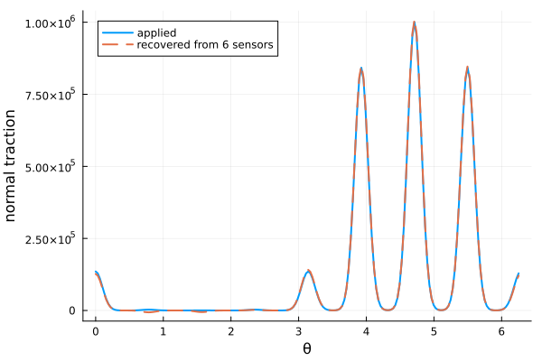
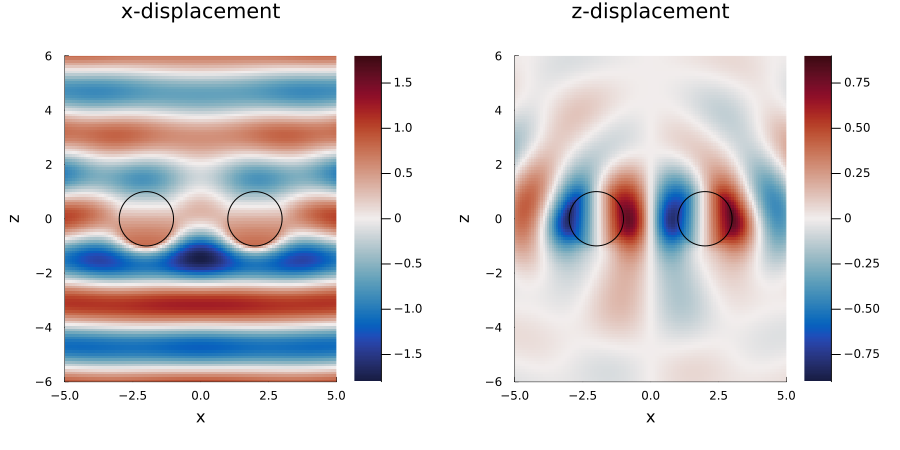

# ElasticWaves.jl

[![][docs-dev-img]][docs-dev-url] [![Build Status][ci-img]][ci-url]

*A Julia package to calculate the propagation and scattering of elastic waves.*

The package is focused on methods which are exact for simple geometries, where the waves can be written as a sum of cylindrical or spherical waves. At the moment there are two main uses:

- **Roller bearings.** Calculate the elastic waves in the raceway of a roller bearing, both when the loads on the raceway are known (the forward problem), and when the loads need to be predicted from sensors on the outside of the bearing (an inverse problem). For details see [Kent, Loures, and Gower (2025)](https://arxiv.org/abs/2412.14928).
- **Scattering from spheres.** Calculate the multiple scattering of elastic waves from elastic spheres in three dimensions, by extending the package [MultipleScattering.jl](https://github.com/JuliaWaveScattering/MultipleScattering.jl).

## Installation

This package is available for Julia 1.10 and beyond. To get started, just add the package by typing
```julia
julia> ]
pkg> add ElasticWaves
```
then press the backspace key followed by
```julia
julia> using ElasticWaves
```
The examples below also use the packages MultipleScattering and Plots, which are installed in the same way.

## Documentation

- [**Latest Documentation**][docs-dev-url] &mdash; *documentation of the in-development version.*

## Example: waves in a roller bearing

The raceway of a roller bearing is the region between two circles. Here it is made of steel, and has eight rollers on the inside.
```julia
using ElasticWaves, MultipleScattering, Plots

steel = Elastic(2; ρ = 7800.0, cp = 5000.0, cs = 3500.0)

bearing = RollerBearing(medium = steel,
    inner_radius = 1.0, outer_radius = 2.0,
    number_of_rollers = 8
)
```

Each roller pushes on a small patch of the inner boundary, and the rollers near the bottom of the bearing carry most of the load. The outer boundary is free of traction.
```julia
ω = 4e4 # the angular frequency

θs = LinRange(0, 2pi, 201)[1:end-1]
θ_rollers = (0:7) .* (2pi / 8)

contact(θ) = exp(-2 * (sin(θ / 2) / 0.1)^2)
load(θ) = 1e6 * exp(-2 * (sin(θ) + 1)^2)

normal = [sum(load(φ) * contact(θ - φ) for φ in θ_rollers) for θ in θs]
shear = 0.1 .* normal # due to friction

inner = BoundaryData(TractionBoundary(inner = true);
    θs = θs, fields = hcat(normal, shear)
)
outer = BoundaryData(TractionBoundary(outer = true);
    θs = θs, fields = zeros(length(θs), 2)
)
```

With the traction known on both boundaries, we can solve for the elastic wave in the raceway, and then plot the stress.
```julia
modal = ModalMethod(modes = -50:50)

sim = BearingSimulation(ω, bearing, inner, outer; method = modal)
wave = ElasticWave(sim)

result = field(wave, bearing, TractionType(); res = 150)
σmax = 0.25 * maximum(abs(σ[1]) for σ in field(result))

plot(result, ω;
    seriestype = :heatmap, field_apply = σ -> real(σ[1]),
    clims = (-σmax, σmax), colorbar = false
)
plot!(bearing)
plot!(title = "", frame = :none, xguide = "", yguide = "")
```


### Predicting the loads from a few sensors

Now suppose we do not know the loads on the rollers. Instead, six sensors measure the displacement on the outer boundary. Below we simulate these measurements, and add 2% noise.
```julia
θ_sensors = LinRange(0, 2pi, 7)[1:end-1]
x_sensors = [bearing.outer_radius .* [cos(θ), sin(θ)] for θ in θ_sensors]

u = stack(displacement(wave, x) for x in x_sensors; dims = 1)
u = u .* (1 .+ 0.02 .* randn(size(u)))

sensors = BoundaryData(DisplacementBoundary(outer = true);
    θs = θ_sensors, fields = u
)
```

Six sensors alone can not resolve the contact of each roller. But we do know where the rollers are, and the shape of each contact. We give this prior knowledge as a basis for the traction on the inner boundary, with one element for each roller. The load on each roller is then fitted to the measurements.
```julia
basis = map(θ_rollers) do φ
    c = [contact(θ - φ) for θ in θs]
    BoundaryData(TractionBoundary(inner = true); θs = θs, fields = hcat(c, 0.1 .* c))
end

method = PriorMethod(modal_method = modal)

inverse_sim = BearingSimulation(ω, method, bearing, sensors, outer;
    boundarybasis1 = BoundaryBasis(basis)
)
inverse_wave = ElasticWave(inverse_sim)
```

To see how well this worked, we compare the traction on the inner boundary with the traction that was applied.
```julia
x_inner = [bearing.inner_radius .* [cos(θ), sin(θ)] for θ in θs]
recovered = [real(traction(inverse_wave, x)[1]) for x in x_inner]

plot(θs, normal, label = "applied", linewidth = 2,
    xguide = "θ", yguide = "normal traction"
)
plot!(θs, recovered, label = "recovered from 6 sensors",
    linewidth = 2, linestyle = :dash
)
```


## Example: scattering from elastic spheres

Elastic media can be used together with all the tools from [MultipleScattering.jl](https://github.com/JuliaWaveScattering/MultipleScattering.jl). Here two spheres scatter a plane shear wave, which travels along the z-axis and is polarised along the x-axis.
```julia
using ElasticWaves, MultipleScattering, Plots

medium = Elastic(3; ρ = 1.0, cp = 1.0, cs = 0.6)
inclusion = Elastic(3; ρ = 3.0, cp = 2.0, cs = 1.2)

particles = [
    Particle(inclusion, Sphere([-2.0, 0.0, 0.0], 1.0)),
    Particle(inclusion, Sphere([ 2.0, 0.0, 0.0], 1.0))
]

source = plane_z_shear_source(medium)
sim = FrequencySimulation(particles, source)
```

We calculate the displacement on the plane `y = 0`, which passes through the centres of both spheres.
```julia
ω = 1.2
region = Box([[-5.0, 0.0, -6.0], [5.0, 0.0, 6.0]])

# the field is not defined on the vertical line through the centre of each sphere
# using res = 121 avoids having grid points on these lines
result = run(sim, region, ω; res = 121)
```

The incident wave has only a displacement in the x direction, so the displacement in the z direction is due only to the waves scattered from the spheres.
```julia
circles = [Circle(origin(p)[[1, 3]], outer_radius(p)) for p in particles]

p1 = plot(result, ω; seriestype = :heatmap,
    field_apply = u -> real(u[1]), clims = (-1.8, 1.8)
)
plot!(p1, circles[1], linecolor = :black)
plot!(p1, circles[2], linecolor = :black)
plot!(p1, title = "x-displacement", yguide = "z")

p2 = plot(result, ω; seriestype = :heatmap,
    field_apply = u -> real(u[3]), clims = (-0.9, 0.9)
)
plot!(p2, circles[1], linecolor = :black)
plot!(p2, circles[2], linecolor = :black)
plot!(p2, title = "z-displacement", yguide = "z")

plot(p1, p2, layout = (1, 2), size = (900, 450), margin = 4Plots.mm)
```


## Reference

If you use the methods for roller bearings, please cite:

> Jessica J. Kent, Matheus de C. Loures, and Art L. Gower, *Elastic waves in bearing raceways: the forward and inverse problem*, Proceedings of the Royal Society A (2025). [arXiv:2412.14928](https://arxiv.org/abs/2412.14928)

## Contributing

If you want to contribute to this package then type
```julia
pkg> dev ElasticWaves
```
By default the package source will now be in \<your julia directory\>/dev/ElasticWaves.

[docs-dev-img]: https://img.shields.io/badge/docs-dev-blue.svg
[docs-dev-url]: https://JuliaWaveScattering.github.io/ElasticWaves.jl/dev/

[ci-img]: https://github.com/JuliaWaveScattering/ElasticWaves.jl/actions/workflows/CI.yml/badge.svg?branch=main
[ci-url]: https://github.com/JuliaWaveScattering/ElasticWaves.jl/actions/workflows/CI.yml?query=branch%3Amain
