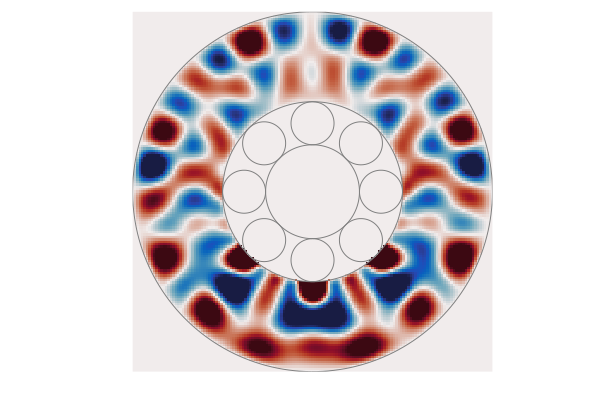

# ElasticWaves.jl

*A Julia package to calculate the propagation and scattering of elastic waves.*

The package is focused on methods which are exact for simple geometries, where the waves can be written as a sum of cylindrical or spherical waves. At the moment there are two main uses:

- **Roller bearings.** Calculate the elastic waves in the raceway of a roller bearing, which is modelled as the region between two concentric circles. Both forward problems, where the loads on the raceway are known, and inverse problems, where the loads are predicted from sensors on the outside of the bearing. See [Waves in a roller bearing](manual/bearing.md).
- **Scattering from spheres.** Calculate the multiple scattering of elastic waves from elastic spheres in three dimensions, by extending the package [MultipleScattering.jl](https://github.com/JuliaWaveScattering/MultipleScattering.jl). See [Scattering from spheres](manual/scattering.md).



All calculations are in the frequency domain, where the fields have the time dependence ``\mathrm e^{-\mathrm i \omega t}`` for an angular frequency ``\omega``.

## Installation

Install Julia v1.10 or later, then run

```julia
] # to enter the package mode
add ElasticWaves
```
Press backspace to exit the package mode.

The examples in this documentation also use the packages [MultipleScattering.jl](https://github.com/JuliaWaveScattering/MultipleScattering.jl), for shapes, particles, and plot recipes, and [Plots.jl](https://github.com/JuliaPlots/Plots.jl). These are installed in the same way.

## Manual

```@contents
Pages = ["manual/bearing.md", "manual/scattering.md"]
Depth = 2
```

## Theory and references

The methods for roller bearings are explained in the paper:

> Jessica J. Kent, Matheus de C. Loures, and Art L. Gower, *Elastic waves in bearing raceways: the forward and inverse problem*, Proceedings of the Royal Society A (2025). [arXiv:2412.14928](https://arxiv.org/abs/2412.14928)

There are also notes in the repository on the [T-matrix of an elastic sphere](https://github.com/JuliaWaveScattering/ElasticWaves.jl/blob/main/docs/theory/ElasticSphereScattering.pdf) and on the [T-matrix of an elastic cylinder](https://github.com/JuliaWaveScattering/ElasticWaves.jl/blob/main/docs/theory/2d_elastic_T_matrix.pdf).

## Library

A list of the documented types and functions is in the [Library](library/library.md).
